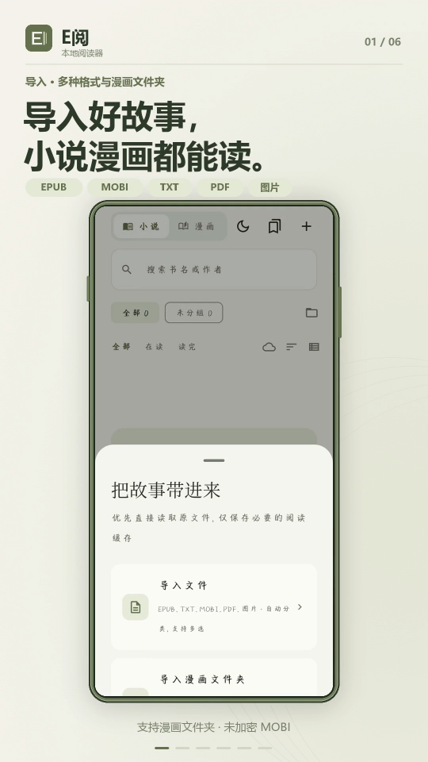
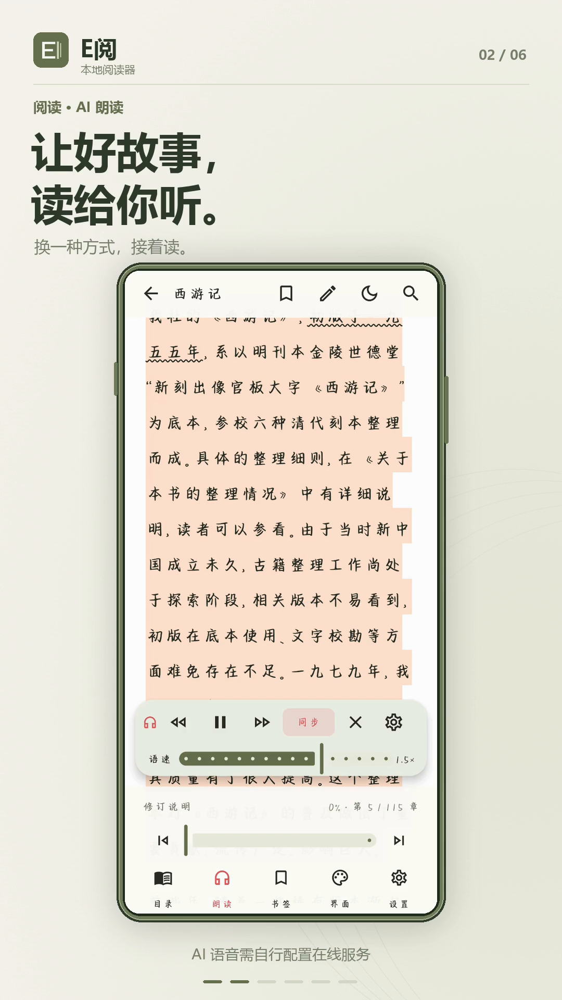
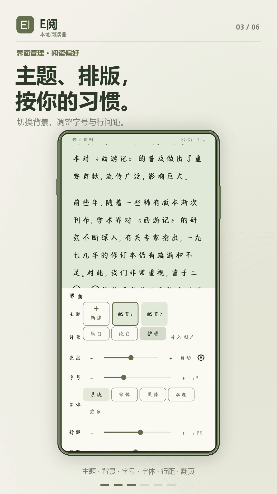
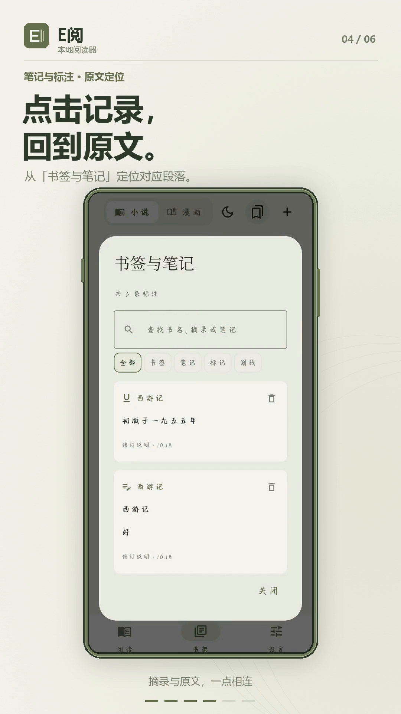
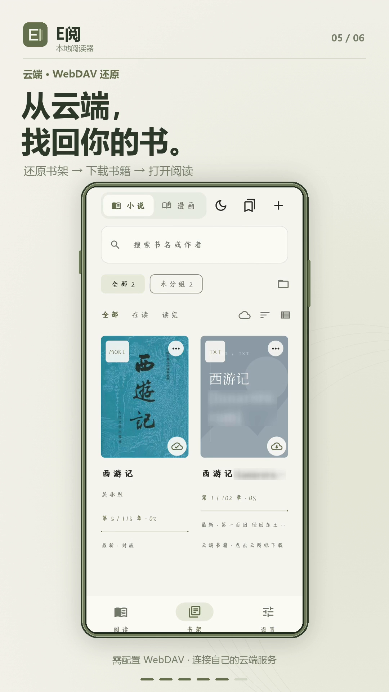
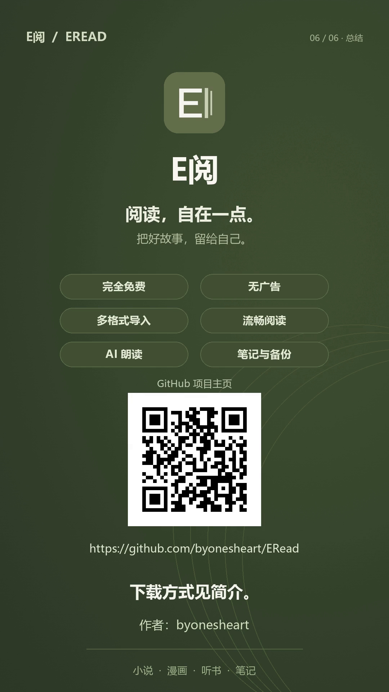

# E阅

一款面向 Android 8.0 及以上设备的本地小说与漫画阅读器，支持看书、听书、阅读标注和个人网盘备份。

开发目录与入口见 [仓库导航](../README.md)，版本变化见 [更新记录](CHANGELOG.md)。Android 安装包存放于 [android/](android/)，Windows 安装包目录为 [windows/](windows/)。

当前版本 **1.11.13**，安装包与提取码见 [仓库首页下载方式](../README.md#下载方式)。

## 软件预览

<table>
  <tr>
    <td width="33%"></td>
    <td width="33%"></td>
    <td width="33%"></td>
  </tr>
  <tr>
    <td width="33%"></td>
    <td width="33%"></td>
    <td width="33%"></td>
  </tr>
</table>

## 软件特点

- **本地优先**：无需注册独立账号，阅读记录保存在自己的设备中。
- **小说与漫画双模式**：分别管理书架分组和阅读偏好。
- **按章阅读原书**：EPUB／MOBI 保留原 HTML 结构与图片，可选原书 CSS 或软件正文样式，沿用书签、注释与朗读。
- **自由定制**：内置宋体、黑体，可导入字体；阅读配置独立保存，软件外观可选经典、像素或星彩主题。
- **看书与听书结合**：系统语音与自配 AI 语音可切换，AI 音频按书缓存。

## 功能

| 类别 | 主要功能 |
| --- | --- |
| 文件导入 | EPUB、TXT、未加密 MOBI、PDF、图片及多层漫画文件夹。 |
| 阅读体验 | 滚动、左右／上下翻页及宽屏双页；左右翻页支持覆盖、滑动、仿真效果。EPUB／MOBI 原结构按章显示，可选原书 CSS 或软件正文格式，字体仍可自选；本章页码、四边边距、折叠目录、原文注释、背景图片、多个阅读配置、简繁转换与深浅主题。 |
| 书架管理 | 可开关的最近阅读、自定义分组、书名与作者搜索、封面和阅读进度；长按管理书籍，批量删除、上传或下载。 |
| 标注与编辑 | 书签、笔记、彩色标记、直线／波浪划线；TXT、EPUB、MOBI 支持全文搜索与替换、文本预览编辑及手动保存。 |
| 有声阅读 | 系统 TTS、自配在线 AI（OpenAI 兼容／MiMo）；段落高亮、页面同步、耳机控制及 AI 整书／选章后台语音缓存。 |
| 云端备份 | 自配 WebDAV，按书或批量备份、分块续传、多本并行上传、可选自动备份与手动还原。 |
| 设备适配 | 墨水屏模式、平板横屏双页阅读。 |

更多功能请自行体验。

## 贡献者

[7Mrlan](https://github.com/7Mrlan)：提供星彩主题的界面设计与参考源码，参与软件测试，发现并反馈多项 Bug。

## 作者交流

作者：**byonesheart**

- [GitHub 仓库 · ERead](https://github.com/byonesheart/ERead)
- [B站 · ByOnesHeart](https://space.bilibili.com/481766725)
- [问题反馈 · GitHub Issues](https://github.com/byonesheart/ERead/issues)
- [QQ群 · E阅交流（538262088）](https://qun.qq.com/universal-share/share?ac=1&authKey=uDvL1dKO4N9Ml3frBbU53mJkECbDfdfOzcEXej2d1tWiP%2BXUQBnNFRCVLGmvmDd8&busi_data=eyJncm91cENvZGUiOiI1MzgyNjIwODgiLCJ0b2tlbiI6IjNZTDVoWmg5c3h4a1lhQXNoNDBrNC9wemRqanhCSk1YWHFYQjUwVzZrQ2hOZk81VHY1Uk9YVmhmZlRmWGdzd0IiLCJ1aW4iOiIzNjE1NDMwODM2In0%3D&data=XZA8m6dBfhaiQ7ZIeOmEyzUudX0Mt1VFSoJmaaCRZ1Pi2LJXFNcyb_Bnl5WHVtRVG5tfe5M7jWEht6EDL8BY8g&svctype=4&tempid=h5_group_info)

如果觉得好用，可以给我点个免费的赞吗？

**打赏完全自愿，不影响软件功能。**

